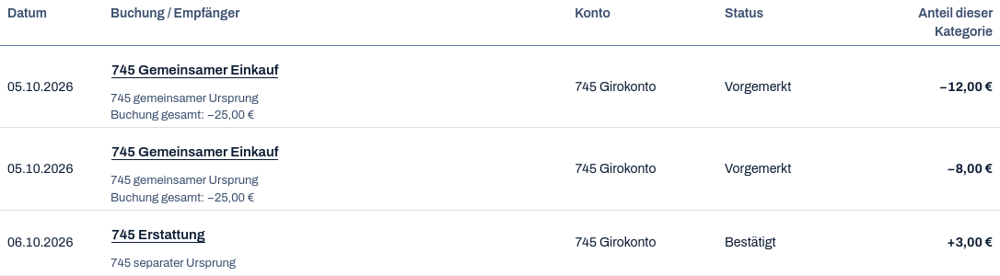
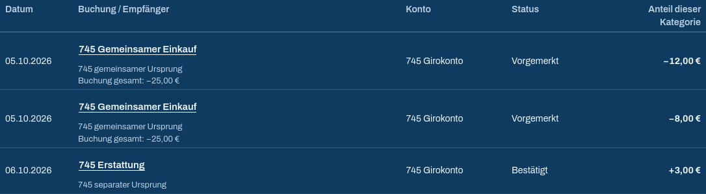
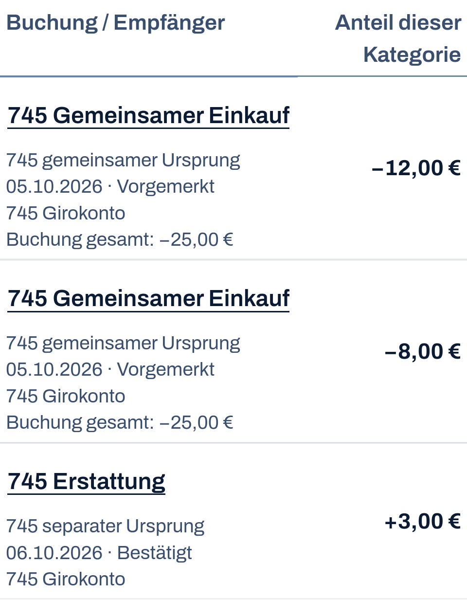
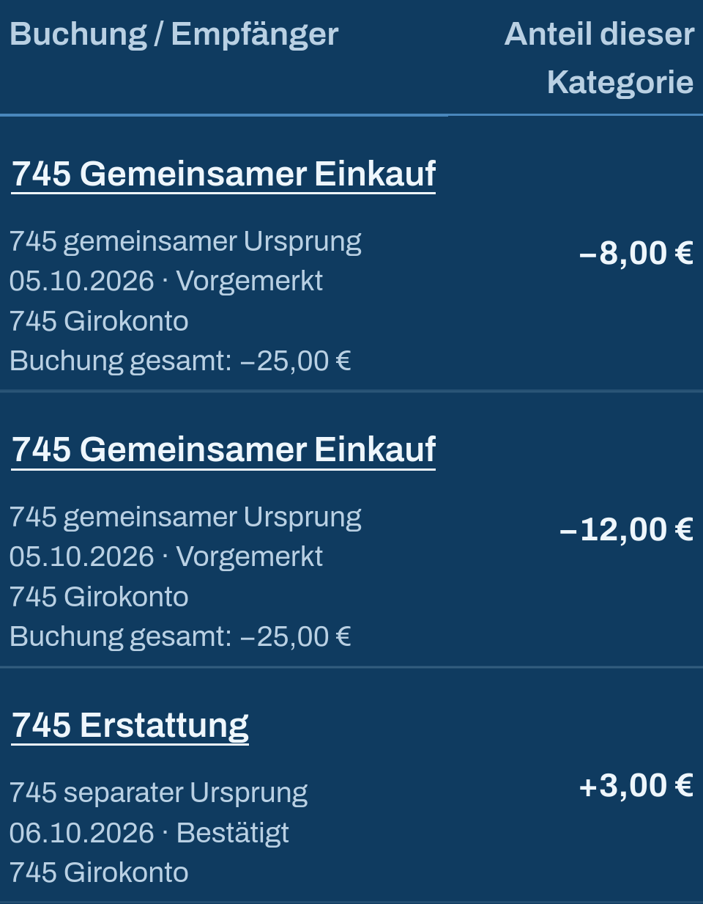

# Compact category activity table (#745)

The category/month detail now presents date, booking, account, status and signed category contribution in a semantic table. Source actions open the existing booking editor. Source totals are labelled separately from individual split contributions; the authoritative category total, pagination and derived card explanations remain unchanged.

At 390px the table uses two visible columns. Date/status and account remain in the booking cell, keeping the date unbroken and the amount alongside the description. Desktop retains five columns. Existing design tokens, keyboard access, amount privacy and 44px actions remain.

## Actual validation

- Product checkpoint `ad4a34dac18f00d3dd36f3e9dcbf1286b54bba54`.
- Initial targeted run: 18/18 (six new component cases, seven unchanged activity UI cases and five unchanged activity API cases), with Web typecheck and scoped static checks passing. After the phone correction, the six affected component cases and scoped static checks passed again.
- Fresh E2E build and canonical WebKit: 7/7 including three setup cases, zero failed/skipped/flaky/retried. Four scenarios cover 1440x900 desktop and configured 390x664 phone, light/dark themes.
- The real synthetic ledger contains two category contributions from the same purchase plus a refund. The category total, source total, account balance, correct editor origin, read-only open/cancel, restored focus and unchanged database/audit state are checked. This adds no new browser Save/Undo claim.
- Current phone example rows are 107–126px high, with a 204px booking column; dates remain on one line. Native touch-target/hit tests, horizontal overflow, privacy and scoped Axe checks pass. The original three-column phone experiment passed functional tests but failed personal visual review; it was replaced before acceptance.
- Independent source reviews and personal original-image review completed. These are browser-emulated profiles, not physical iPhone certification.
- Required `BUDGET_REQUIRE_AGE=1 VITEST_MAX_WORKERS=2 npm run check`: passed; 590 test files, 5219 tests, zero failed/skipped. Check wall time 703.129s. Normal `npm run build`: passed in 8.337s. Source and process guards passed.
- Continuation: the prepared technical adapter is applied to `e2e/issue-735-plan-activity.spec.ts` under the owner’s standing UI/API test authorization. The table separates date and account into cells, so the former joined whole-list text check becomes two exact text checks on the same `firstContribution` row. All amount, source, count, order, security, audit, Save/Undo and timeout expectations remain unchanged. The prepared before/candidate hashes match; independent adapter review is retained in `docs/handoff/745/reviews/745-current89327-format-and-old735-adapter-independent-high.md`.
- The product and component-test files are byte-identical to `ad4a34dac18f00d3dd36f3e9dcbf1286b54bba54`. The continuation inherits the separately reviewed and live #747 repair from main `fb7490d3`; the only merge conflict appended both ROADMAP sections. Historical results retain their tested revision and are not current-head CI.
- Fresh continuation checks: 18/18 targeted cases (six new table component, seven existing activity UI, five existing activity API), scoped ESLint/Prettier and E2E build passed. Independent Codex continuation review confirms exact source correspondence, unchanged financial/Undo oracles and the prepared adapter; no findings. The first supplemental Chromium run passed all twelve existing #735 cases and six of eight new #745 cases (21/23 including setup); two phone cases exposed the test scroll-position problem described below. After the centered-scroll setup correction, the complete new #745 desktop/mobile suite passed 11/11 (three setup + eight feature cases) in 39.3s with no failures, skips or retries. The unchanged existing #735 suite retains its 12/12 pass, including actual Save/Undo. Independent review of the scroll-only delta passed without findings; no duplicate full local suite was run.
- `e2e/issue-745-activity-table.spec.ts`: Chromium’s nearest scrolling placed the third source button behind the fixed bottom navigation at 390×844 (button y=799.59, height=44; center y=821.59, tabbar starts at780). The new test centers the target before measuring, matching a user scrolling it into an unobscured position. Every original 44px, full-viewport and center-hit assertion remains, as do financial/privacy/editor/no-write expectations and timeouts. Product layout and navigation are unchanged. Historical WebKit evidence predates this mechanical test setup adjustment; required current CI remains separate.
- Canonical Chromium CI and LIVE verification: pending. No production financial data changed.

## Original screenshots

These are unedited table captures from the four current browser scenarios, not visual baseline replacements. Full-page originals and geometry are retained in the external execution archive.

| Desktop light | Desktop dark |
| --- | --- |
|  |  |

| Phone light | Phone dark |
| --- | --- |
|  |  |
