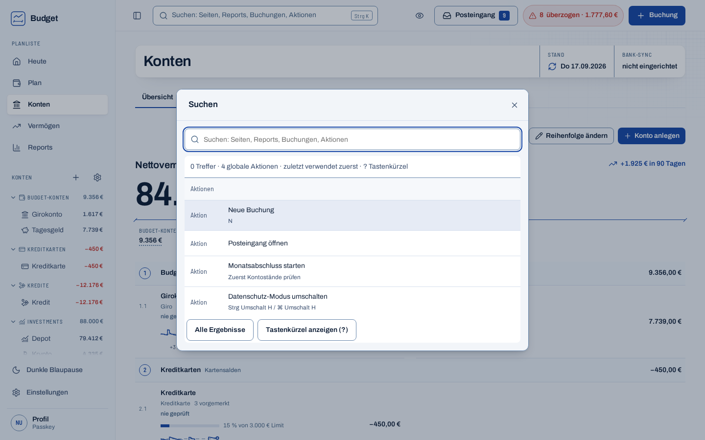
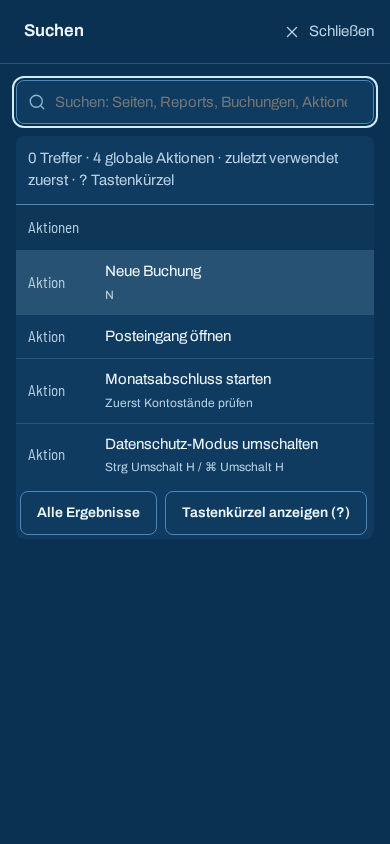
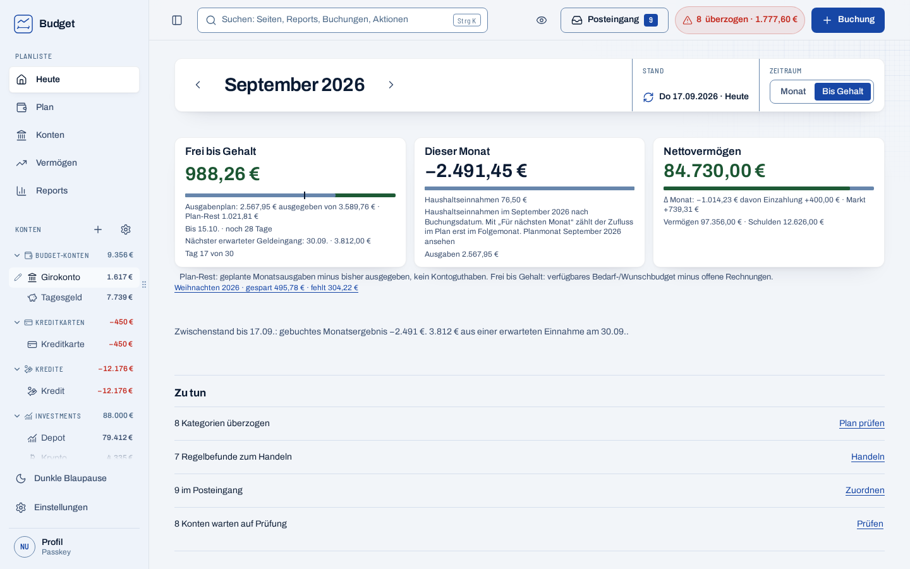
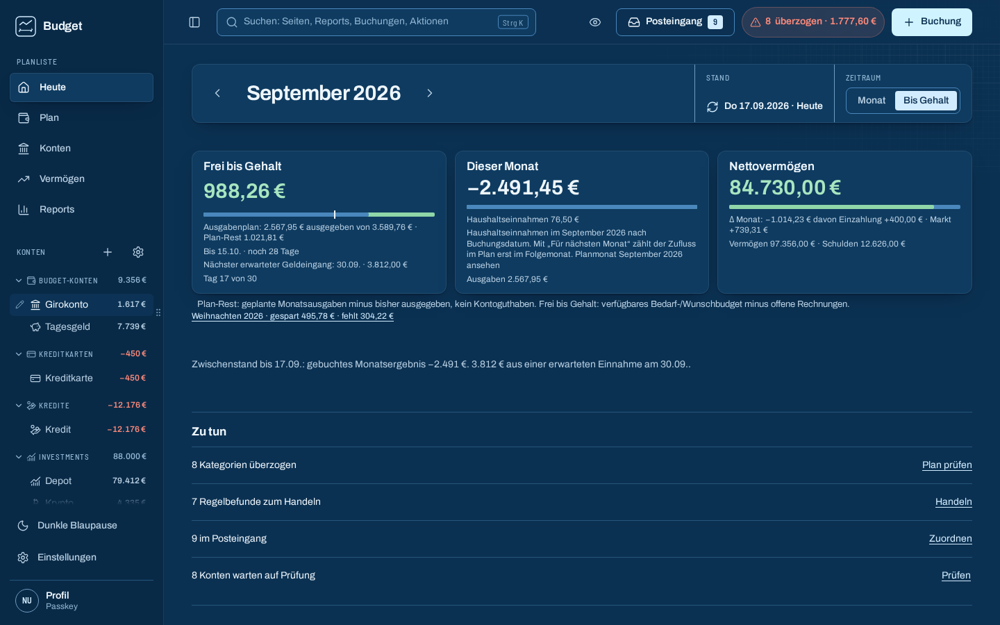

# Search overlay and sidebar resize evidence

Global search opens over the current page, keeping the source URL, month, scroll position and meaningful keyboard focus. Escape restores the context that opened it. The native dialog remains the mobile full-screen sheet. Search destinations, validated `/suche?typ=` filtering, loading/error states, pending-result handling and recent choices reuse existing routes and providers; financial calculations and write paths are unchanged.

The desktop navigation sidebar now has a hover-revealed resize handle. Pointer dragging and slider keyboard controls adjust it from 200 px to 360 px; the selected width persists across reloads. The collapsed sidebar hides the handle and restores the selected width when expanded.

## Validation

- Main #502 was integrated before this final source tree. The final `npm run check` passed with Node 22.23.3: 434 test files and 3,944 tests passed, with zero skipped. It ran with `BUDGET_REQUIRE_AGE=1` and `/workspace/.budget-tools/age/usr/bin` on `PATH`; typechecks, lint, CSS token check and formatting passed. ESLint reported one existing unused-disable warning in `packages/ui/src/components/panel.tsx`. Full-check log: `/workspace/work/search-post-pwa-check.log`.
- `npm run build:e2e` passed.
- With the old repository-pinned Playwright 1.56.1 Chromium, the desktop and mobile focused suite had 25 passed and 2 skipped (`e2e/global-search.spec.ts` and `e2e/sidebar-resize.spec.ts`, 2 workers). It covered 1440×900 and 390×844 viewports, pointer and keyboard resize, width limits and persistence, search navigation and context preservation, Escape focus return, and Axe in light and dark themes. This does not validate Chromium 1.64.1; the local 1.64.1 browser download was blocked as described below.
- On the repository-pinned Playwright 1.56.1 / WebKit 2215, the WebKit iPhone focused search suite had 12 passed, 1 skipped, 1 failed (1 worker). Search keyboard/focus, context restoration and Axe cases passed. In “result types open existing category, payee, contact and exact booking views”, WebKit crashed at `page.reload()` (`e2e/global-search.spec.ts:84`) after the earlier contact search result was opened, reloaded and left via “Zurück zu Kontakte”. `DEBUG=pw:browser` captured a WebKit child assertion in libstdc++ `optional` (`_M_is_engaged()`), followed by `Page crashed`; cgroup `memory.events` showed no max/oom/oom_kill events. This is historical evidence from the old runtime.
- Direct entry and reload of `/konten/buchungen?buchung=bk-004219` passed on both this build and the read-only `/workspace/work/payslip` build with the same WebKit runtime, synthetic sample database and session. The crash is not specific to the overlay: the existing full-page-search test against the read-only Payslip/main build also reproduced it at booking reload after contact result → contact reload → “Zurück zu Kontakte” → booking result. Stronger readiness checks (real zero balance, empty movement state, no loading status, fonts ready) did not change that result. A contact-name `AppLink` → contact reload → back → same booking navigation also reproduced the failure, while direct contact-route navigation with the matching `?verlauf=1` context passed; changing only the search input from `type=search` to `type=text` did not help. A trial that synchronously closed the overlay and restored focus before navigation did not remove the old-runtime failure.

  The same old full-page-search flow with stronger readiness checks passed on an isolated Playwright 1.64.1 / WebKit 2.55.0 installation (1/1), and the current overlay flow with the same synthetic contact and booking also passed (1/1). Both runs used the existing build/database and no repository changes. GitHub CI on the old repository-pinned runtime independently failed `[webkit-iphone]` at booking reload (`e2e/global-search.spec.ts:84`); its annotation reports 336 passed, 35 skipped, and one failure in shard 3. The exact native crash detail remains unavailable because the 65 MB report and job log return Azure Blob `403 Forbidden`. The 1.64.1 WebKit iPhone run on the integrated tree passed all 19 selected tests with one existing skip (1 worker) across `global-search`, `accounts-settings` and `payslip-intake`, including the formerly crashing search result navigation. This used WebKit 2.55.0 (revision 2370) from the isolated 1.64.1 install and `PLAYWRIGHT_SKIP_VALIDATE_HOST_REQUIREMENTS=1` only to bypass the host preflight; the browser launched and ran the DOM assertions. Chromium 1.64.1 could not be installed locally: the Playwright-supported installer’s CDN returned HTTP 403 `Domain forbidden`. No older Chromium was used as a substitute. GitHub CI with official Playwright 1.64.1 browser installs is needed to complete local Chromium verification. No test assertion, skip, baseline or repository browser configuration was weakened.

  PR #501 CI run [`38722557178`](https://github.com/Grabman1987/budget/actions/runs/38722557178) successfully installed Playwright 1.64.1 Chromium and WebKit and passed build, unit and Windows checks. The WebKit search flow that crashed on 1.56.1 passed. Its successor, [`38725867887`](https://github.com/Grabman1987/budget/actions/runs/38725867887), provided available completed-job logs for the previously reported failures. In desktop and mobile PWA tests, offline mode was active before reload and the service worker returned the shell with HTTP 200, but the reloaded page reported `navigator.onLine === true`; three `/api/auth/status` requests failed with `net::ERR_INTERNET_DISCONNECTED`, and the app had no heading. This showed that the existing browser-online signal alone cannot distinguish a shell reload with failed initial authentication. `PwaShell` now also observes the existing auth-status query: an initial network failure with no auth data selects the offline shell, while a later refresh failure with cached auth data leaves the live page mounted. No health poll, timer or API caching was added. The complete PWA unit suite now has six tests, including both initial-auth failure and later-refresh failure regressions; the existing offline, privacy and draft-preservation assertions remain.

  The same CI run reported stale rendered colors in Wealth/Components and mobile chart contrast, plus a sidebar collapse measurement taken before the collapsed state committed. The sidebar test now waits for the collapsed class; Wealth and chart tests wait for the actual rendered SVG fill to match the resolved theme token before retaining their original color/contrast assertions; Components waits for each exact body background color through `toHaveCSS`. These waits keep the original expected colors and thresholds. The final integrated source and unit suite passed locally, but the official final-head browser CI is still pending. No local Chromium 1.64.1 pass is claimed; its supported installer was blocked by CDN HTTP 403. No test assertions, skips or visual baselines were weakened or updated.

## Screenshots

Generated from the synthetic sample ledger. They are evidence, not regenerated visual-test baselines.

## Scope and remaining acceptance

This work addresses search issue #484 and the resize criterion in #499. It does not close all of Q5 / #468: mobile tab labels, header/status behavior, FAB overlap, focus/back navigation beyond the covered search flow, sidebar groups and offline status remain separate acceptance findings. Owner acceptance on a physical iPhone and desktop is still outstanding. No keys, consents, migrations, configuration or deployment steps are required.
