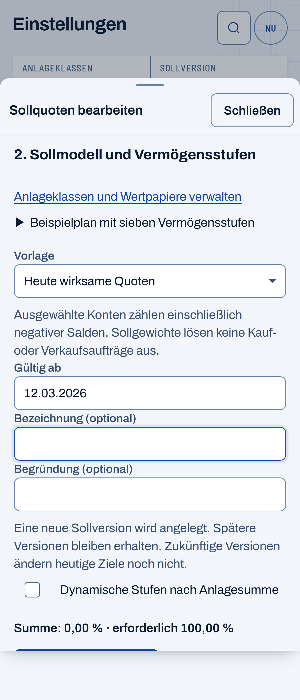

# Shared date keyboard — #731

Shared German date fields now request a text keyboard, which supports punctuation. The date parser, partial editing, validity, limits, ISO form values and financial actions are unchanged.

The new unit test first failed on the previous `inputMode="numeric"` hint. After the one-line correction, all ten focused cases passed: the new sequential typing case, both unchanged shared-date cases and seven wealth-stage cases. UI/Web typechecks and affected lint/format checks passed. The only existing-test adaptation changes the wealth-stage keyboard-hint expectation from `numeric` to `text`; its date, money, save, conflict and Undo checks remain intact. This follows the owner's decision to allow dotted date entry and the existing policy for independently reviewed adaptations to decided UI behavior.

Canonical WebKit passed four cases on 20 October 2026: one new browser case and three setup cases, with no failures, skips, retries or flaky results. A fresh E2E build preceded the run. The real isolated application received sequential `12.0`, then `3.2026`; incomplete input remained editable and invalid, the complete `12.03.2026` became valid, and Tab moved focus onward. The target-version response stayed identical and no application write request occurred. Source files, Git state and compiled files remained unchanged during the browser test.

The browser context measured 390 × 844 CSS pixels, DPR 3 and a coarse pointer. The date control met the 44px minimum, and the document had no horizontal overflow. The unedited full-page capture below is 1170 × 2724 physical pixels; it includes more than one viewport and proves only this read-only date-entry flow. It does not certify a physical iPhone keyboard, its native picker, or the complete editor's save flow. The preceding stage-table delivery has separate save/Undo evidence.

`BUDGET_REQUIRE_AGE=1 npm run check` passes 570 files / 5,076 tests with one worker; the normal production build also passes. All source files and Git state remained unchanged during the checks. These results precede only this documentation update. Exact-head CI and live delivery remain pending.
