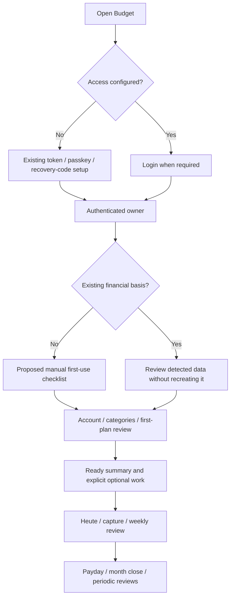
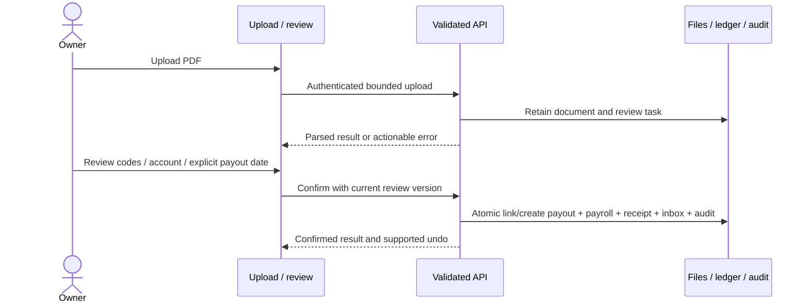

# Journeys and service handoffs

Concrete expansion of PR01–08 in [processes](processes.md). Existing feature
contracts govern writes. These sequences define expected journey coverage;
they do not assert that every routine already has a delivered wizard.

## From first access to habitual use

Financial checklist G–J is proposed ONB01. Auth and ordinary destinations exist.
Migration-pending branch explains operator assistance and returns to review of
the actual resulting data; it contains no upload/import UI.

## Detailed routine stages

| Routine | Ordered user/system handoffs | Exit and recovery |
| --- | --- | --- |
| PR01 Source run | Scheduler checks due/catch-up → adapter fetches bounded source → validate/deduplicate → apply configured posting policy → retain candidate/review work → update success/coverage → owner sees action if needed | Source success means that source/window only. Partial source failure retains other success; retry uses same source identities |
| PR02 Capture | Open global/account capture → choose existing account/date → enter gross amount/payee → category/contact lines → exact remainder validation → durable submit → explicit queued/server result → toast/undo → original context | Local capture and posted cash are distinct. Lost response resolves stable key before edit/delete; invalid/reconciled data stays actionable |
| PR03 Weekly | Open Heute tasks/inbox → select source/filter → inspect source detail → categorize/confirm/link/dismiss through current API → inspect retained warnings → review account/Pace → return | Zero actionable work or reasoned deferral, not an artificial “all finances correct” message. Filter-empty and all-empty differ |
| PR04 Payday | Verify actual receipt/account → inspect actual unassigned pool → review goals/commitments → waterfall preview → explicitly apply allocations → inspect remainder/underfunding → undo if needed | Do not allocate forecast salary as cash; draft and applied stages explicit. Preserve completed saves if interrupted |
| PR05 Month close | Choose month → bookings/inbox → account checks/manual values → overspending/contacts → next-month zero-based plan → shared One-Pager/deviations → server close marker | Five-step live status, reasoned exceptions and resume. Server rejects premature/stale/incomplete close; financial gate remains independent |
| PR06 Quarter | Inspect coverage/as-of → review portfolio/targets/risk → debts/contracts/consents → compare supported proposals → save chosen metadata/plan changes → separately execute externally → confirm actual execution | Missing valuation/terms suppress unsupported proposals. No bank order; unexecuted changes stay explicitly planned |
| PR07 Year | Select year/coverage → review year report → recurring/annual obligations → category/goal/contract changes → future monthly distribution → review assumptions → separately perform/document restore exercise | Planning never invents booked income. Restore evidence follows operations, not an automatic checkbox |
| PR08 Event | Open annual/liquidity context → define supported dated change → baseline/scenario comparison → inspect assumptions → explicitly save supported event/pause → inspect new forecast → undo if appropriate | Local comparison distinct from applied configuration; actual ledger unchanged; broad replacement-income semantics remain outside first pause slice |

## Payroll sequence

Password/read errors, unknown numeric codes, duplicate PDFs, conflicting matching
payouts and missing dates all return to the review step. Upload never books money.
See the current G01–G11 design references in [screen contracts](screen-contracts.md).

## Navigation contracts at handoff

Carry valid selected month/period/filters into linked detail; show breadcrumbs and
back destination; preserve source scroll/focus where relevant. On session expiry,
only validated local continuations are accepted. A financial mutation refreshes
its affected shared read models before showing derived completion. Error/undo
messages must describe the actual outcome rather than only closing the dialog.
