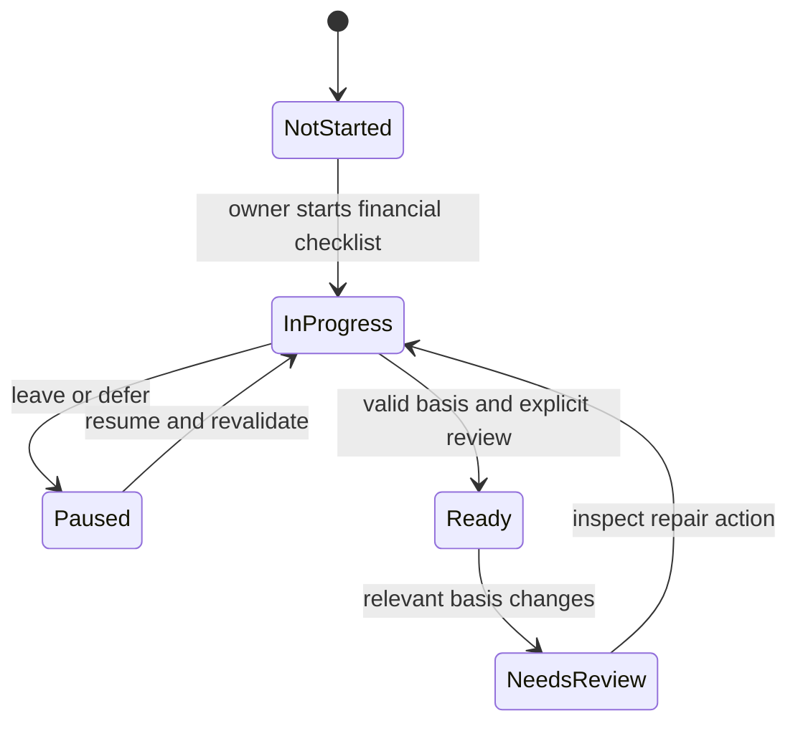

# States, permissions and recovery

Business meaning, not a replacement database enum. Existing code determines stored
states; proposed onboarding-only states must not be presented as existing schema.

## Actor and authorization matrix

| Actor / session | Allowed | Additional restriction |
| --- | --- | --- |
| Unauthenticated visitor | Login; first-device bootstrap only while permitted | No ledger, reports, attachments or progress data |
| Owner via passkey | Read/manage household through validated APIs | Audit, reconciliation locks and dependencies still apply |
| Owner via recovery | Recover access and permitted ordinary work | Restricted source actions require passkey-authenticated session |
| Owner with fresh step-up | Sensitive export/security action | Five-minute policy and server authorization, not a client checkbox |
| Worker | Configured bounded source operations | No interactive owner consent, speculative categorization or bank order |
| Operator | Deployment/restore; separately authorized private migration | No new household login role; production actions remain separately scoped |
| Contact | Referenced person/entity in the ledger | No login, invitation or access to household records |

## Financial state transitions

| Object | Normal progression | Reversal / blocking rule |
| --- | --- | --- |
| Booking | Draft → locally queued if applicable → pending or confirmed → reconciled | Cash starts confirmed; checks protect older writes; undo respects dependent records |
| Offline item | Durable local → sending/uncertain → acknowledged and removed; rejection retains reason | Same key/body resolves uncertainty; a blocked first item holds later FIFO items |
| Account | Active → closed; metadata edits audited | Closure retains history; required confirmations and dependent depot links remain |
| Bank source line | BOOK → pending booking by policy; PDNG → candidate → confirm/link/dismiss | Stable source IDs and deleted-record tombstones stop duplicate posting |
| Expected payment | Active schedule + dated versions → planned occurrence → matched/otherwise resolved | Future replanning retains actual history; pause changes forecast, never actual bookings |
| Contact outlay | Open → partly repaid → settled; overpayment creates credit | Receipt allocation, credit and cash reverse together; persisted settlement defines history boundary |
| Payslip | Uploaded → parsed/review or parse failure → confirm/reject; reanalysis when allowed | Upload never posts; preserve manual corrections and existing payout links; concurrent review conflicts |
| Receipt | Uploaded blob + metadata → linked/unlinked | Booking deletion does not erase the backup-required attachment; repository retention contract applies |
| Savings schedule | Dated current/future versions → due proposal → owner-confirmed execution | Rate change never executes; one live confirmation per execution identity; undo supported |
| Exposure/target version | Effective dated set → explicit replacement/retirement | Preserve history; complete set totals 10000 bp; retirement cannot break dependencies |
| Rule result | Disabled, unavailable or evaluated as ok/warn/bad | Missing data is unavailable; acknowledgement is not financial repair |
| Month close | Not started → live work/reasoned exceptions → next-month plan → reviewed/closed marker | New work reopens steps; close marker locks no ledger records |
| Scenario | Local comparison → explicit saved supported event/change | Never silently becomes a booked amount or historical rewrite |

## Shared failure model

| Situation | User sees | Recovery and data guarantee |
| --- | --- | --- |
| Loading | Named loading region, stable context | No false zero values; prevent duplicate submission while outcome is pending |
| Empty | What is missing and one relevant action | Distinguish no records from filtered-out records and unavailable data |
| Invalid input | German field-level reason and focusable summary | Keep input, make no partial financial write |
| Session lost | Login action and safe return destination | Retain device-local queue; do not expose protected data through cached API responses |
| Conflict/stale fingerprint | Explain that the source changed; refresh/review action | Reject stale mutation rather than silently overwrite financial state |
| Locked/dependent record | Name the check/dependency and route to inspect it | No automatic forced undo or breaking linked trade/receipt allocation |
| Offline/timeout | Saved locally, unsaved, or outcome uncertain, explicitly distinguished | Never claim server success from a local save; replay only stable requests |
| Partial coverage | Source/date/period gap and affected figures | Preserve independent usable values; no fabricated history |
| Source authorization expired | Reconnect action, last successful data date | Do not erase the known ledger or repeatedly request unavailable consent |
| Generic server failure | Plain retry guidance and retained context | No raw SQL, provider response, credential or internal exception in UI |

## Proposed onboarding transitions

`NeedsReview` is a presentation condition, not a new permission lock. Failures
leave the last saved progress intact. Technical auth setup remains independent.
See [onboarding](onboarding.md) for readiness and cross-device proposal details.
