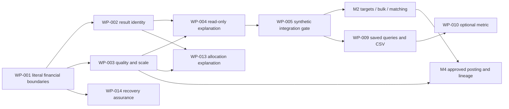

# Roadmap and local implementation backlog

**Owner decision update:** [Reference adoption](../reference-adoption.md) supersedes this proposal's end-flow/default-preservation recommendation. PP returns are the standard; database-backed Explorer views and preparation of limited transfers are approved. Estimates below are the historical proposal, not implemented features.

Current execution: [GitHub backlog index](../github-backlog.md), synchronized by the separate owner request on 2026-10-16. Issue contracts override the historical default-preservation and pending-storage-choice wording below. An issue is an open task, not evidence of a released feature.

Proposal dated 2026-10-15 against `01a10de8`; [target model](../target-model.md), [specifications](../specs/README.md), [row-level trace](../feature-matrix/features.csv). This is versionable local planning. No issue, PR, repository setting, product implementation, push or deployment is created by this document.

Estimates are focused **engineer-days**, including meaningful tests/review, not elapsed delivery promises. They assume the pinned architecture and current dependencies work, exclude waiting for private/provider/policy evidence, and must be revised after the first bounded slice. Existing passing tests or deployed features are not billed as new implementation. If a response/UI already meets a proposed explanation, retain it and record evidence instead of rebuilding it.

## Increments, priorities and gates

| Increment | Value and scope | Priority / reason | Rough effort and uncertainty | Exit gate |
| --- | --- | --- | --- | --- |
| M0 Research baseline | Four bounded analyses, full disposition matrix, coherent model/specs | Completed research | Not an implementation estimate | Final review/trace checks, known gaps explicit |
| M1 Financial interpretation | Existing scope/method/timing/quality visible; literal boundary fixtures; no change to financial defaults | P0 assurance; P1 explanation UI | 4.5–11 days summed across WP-001–005, medium; DTO reuse may reduce scope | Synthetic cross-layer/browser checks and unchanged numerical outputs; private parity stays open |
| M2 Safer daily steering | Weekly/snoozed targets, selected funding preview, bulk date/memo/payee, matching explanations, offline/recovery assurance | P1 user effort and data integrity | 11–24 days if every WP-006/007/008/014 is accepted, medium/high; ship each independently | Each package's acceptance, grouped undo/rollback and relevant migration/browser checks |
| M3 Reusable analysis | Existing Explorer preferences/filtered CSV, allocation explanation; metric denominator clarity and optional runway | P2; optional runway P3 because present forecasts/pace already help | 5–12 days across WP-009/010/013, medium; prefer current DTO/UI | Saved-query/export accuracy, no new calculation path, missing-data suppression remains |
| M4 Provenance-sensitive transfers | Same-security cross-account lot lineage; conditional cross-currency cash posting | P2 value but high financial risk/dependency | 9–19 days across WP-011/012 **after** policy/design approval, high; replay/migration edges may widen | Accepted exact posting/lineage contract, independent conservation/scope/undo evidence |

Do not sum these ranges into a delivery date: choices are conditional, work overlaps with existing code, operational waiting is excluded and the owner may select a smaller path. P0 is reserved for proving/interpreting financial correctness. A reference-product control does not gain priority simply because it exists.

## Critical path and independent work

M1 critical path: WP-001 → longer of WP-002/WP-003 → WP-004 → WP-005. WP-002/003 are independent after the invariant contract is fixed. M2 target, bulk and matching packages can be sequenced independently; each mutates its own reviewed slice. WP-014 can follow WP-001 without waiting for M2 product work. Allocation explanation does not depend on implementing security transfers. Conditional M4 policies and source provenance are genuine gates; time passing is not approval.

## First increment: executable packages

The machine-readable [work-package index](work-packages.csv) contains exact specification/capability/acceptance IDs and dependencies for all 14 packages. Source feature IDs resolve by joining `features.csv.work_package_id`; reused behavior and excluded variants keep their row-level interpretation. For M1:

### WP-001 — Literal financial boundary evidence

- **Inputs:** baseline ledger/card/reconciliation/debt source; SPEC-001; CASE-001–007. Feature families YNAB-001–019/039–051/080 and ACT envelope/ledger cases via CAP-001/002/005/006/009.
- **Work:** audit existing tests against literal cases; add only uncovered tests using existing synthetic seed facilities. Exercise source-to-account/envelope boundary, mixed funded/unfunded cards, partial split, transfer failure/undo and statement date/lock. Separate existing test claims from newly executed evidence.
- **Files to inspect/change:** `packages/domain/src/ledger/*.test.ts`, current repository booking/reconciliation tests, `apps/server/src/api/{budget,accounts,bookings,debts}.test.ts`; no new fixture generator or private source data.
- **Acceptance:** AC-001-01–04. One hand-derived expected amount per invariant, API/repository agreement and rollback/undo state comparison. A discovered numerical defect is a separate bounded fix with owner-spec precedence, not an excuse to replace the model.
- **Size/risk:** 1–2 days, medium; missing coverage or contradictory legacy behavior can become a separate dependency. Review before metadata work consumes these contracts.

### WP-002 — Calculation identity on existing investment reads

- **Inputs:** WP-001, SPEC-007, PP-001–006/011–014/019 and Budget's current end-flow/after-cost scopes. CASE-008/009/010.
- **Work:** compare current DTOs to the minimum descriptor; add only missing method, flow timing, scope, fee/tax basis and explicit persisted cost preference. Build metadata alongside the existing calculation without recomputing financial figures. Preserve current labels that already distinguish Dietz/XIRR/security-only scope.
- **Files:** `packages/domain/src/invest/{returns,performance,cost}.ts` as calculation references; derived DTO types/builders under `packages/db/src/repos/{portfolio,portfolio-summary}.ts`, existing investment API responses and tests. No new financial table/algorithm/provider.
- **Acceptance:** AC-007-01/02/04. Prior 100 + inflow 100 + end 220 remains Budget 20%, with PP 10% explicitly a reference convention. Existing values unchanged; descriptor matches the actual caller's options.
- **Size/risk:** 1–3 days, medium; scope/legacy low-level defaults need call-site review. Stop on a required numerical policy change.

### WP-003 — Valuation quality and precision assurance

- **Inputs:** WP-001, SPEC-008, PP-007–010/110, YNAB-073/075 and CASE-012/013.
- **Work:** reuse existing valuation details and nullable totals; check consumers preserve actual quote/trade/FX dates, stale/estimated/look-ahead reasons and missing states. Add missing read metadata only. Verify lossless scale boundary fixtures in operator adapters without applying a real migration or rewriting stored values.
- **Files:** `packages/domain/src/invest/series.ts`, `packages/db/src/repos/{portfolio,market}.ts`, existing quote/FX/series/adapter test paths and additive response fields. No transfer workflow or quote fallback replacement.
- **Acceptance:** AC-008-01/02/03. Missing FX cannot become parity/complete total; native cash remains usable; nondivisible milliunits/quote precision has an explicit review/error outcome.
- **Size/risk:** 0.5–2 days, medium; reuse may make this mainly evidence. Conditional transfer posting remains WP-011.

### WP-004 — Read-only explanation in the current design

- **Inputs:** WP-002/003 typed descriptors; SPEC-007/008 and current SPEC/DESIGN overrides.
- **Work:** extend existing Term/quality/detail surfaces where facts are missing. Show scope/timing/cost/valuation identity with period and source links. Retain Vermögen's compact overview and Reports' deeper analysis; no permanent detail panel or second metric calculation.
- **Files:** `apps/web/src/pages/portfolio-performance-report.tsx`, existing wealth overview/quality detail, `apps/web/src/reports/term.tsx` and current shared API types/tests. Do not move period controls onto non-chart details.
- **Acceptance:** AC-007-03 and AC-008-01/02. Authenticated synthetic desktop 1440 and phone 390, light/dark, keyboard/accessible controls, masked values, missing data, deep-link/back context and unchanged money/geometry.
- **Size/risk:** 1–2 days, medium. No writes or new settings controls; use current components and tokens.

### WP-005 — Integration evidence and readiness statement

- **Inputs:** frozen WP-001–004 tree and exact acceptance IDs in the CSV.
- **Work:** run focused financial/API/browser tests, then repository-required full checks for the authorized implementation slice. Record exact revision, commands, results and synthetic screenshots in normal evidence conventions. Independently review unchanged financial figures and cross-consumer identity. Recheck after material repairs.
- **Acceptance:** all M1 AC-001, AC-007 and AC-008-01–03; no new financial mutations/history rewrite; explicit remaining source/device/private/production gates. This package does not create issues, PRs, merge or deployment automatically.
- **Size/risk:** 1–2 days, medium; environment failures are reported precisely. “Synthetic implementation ready” is not full owner financial acceptance or a live deployment claim.

## Later package guidance and risks

- **WP-006:** split weekly cadence/snooze and preview/apply into reviewable tasks if necessary; target intent migration must preserve null legacy interpretation and history. Funding/order/locks are shared dependencies, not UI-only changes.
- **WP-007:** add only field-specific bulk scope; protected linked records and transfer-date counterpart effects are blocked initially. Verify one audit group and stale preview failure.
- **WP-008:** prove current four-day exact unique auto-link, five-day suggestions and 21-day overlap; fallback-key batching/ordinal limits remain explicit. Do not generalize source-provider reliability from synthetic tests.
- **WP-009:** saved query sync requires a preference schema decision and recoverable local merge. CSV remains bounded to one valid Explorer query with explicit units/truncation; no dashboard builder.
- **WP-010:** existing metric explanations first. Numeric runway is optional after a distinct need is accepted; it does not redefine Available or predict payment sufficiency.
- **WP-011:** require approved native-leg/execution-rate/spread/fee/rounding contract and lossless source interpretation. Same-currency rejection must not be relaxed prematurely; no automatic bank matching in the first new variant.
- **WP-012:** high uncertainty: cross-account cost replay, backdated changes, same-day lineage, snapshots, unknown basis and fractional lots. After bounded design acceptance, stage A within the 6–12-day package proves the exact FIFO/average/conservation/rejection cases in SPEC-009 §15; a reviewer accepts AC-009-01/02 before stage B persistence/API and stage C UI/undo. This is estimated work inside WP-012, not an unspecified earlier gate. A relation alone is not a FIFO provenance engine. Same instrument/currency/1:1 scope only; general corporate/tax operations remain deferred.
- **WP-013:** current allocation is implemented. Prove a missing explanation before adding fields; retain dated exposures/targets, signed cash, quality guards and two-level hierarchy. No dependency on future transfers.
- **WP-014:** synthetic isolated receipt-aware restore and capture retry tests use disposable data/keys; actual owner key custody/provider/device evidence remains an operational task. Keep CSV/backup/sync distinct and step-up configuration driven.

Deferred/non-goals remain traceable in the matrix: Together/multiple plans/Fresh Start engines, in-app file import, Toolkit host administration/theme options, arbitrary AQL, PP timing/pre-tax modes, standalone FX-gain attribution without provenance, stochastic forecast/dashboard builders, specialized bond accrual and general spin-off/merger/tax engines. Reopen only with a concrete task, valid data/policy and revised scoped specification. License provenance must be checked before copying upstream implementation; independent domain implementation is the default.
