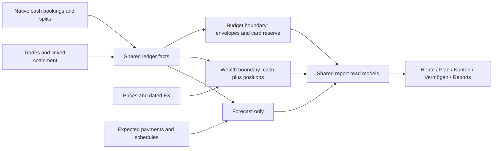

# Combined budget and wealth model

**Adoption update:** [Owner decisions](reference-adoption.md) supersede the end-flow/default-preservation recommendation below and approve cross-device Explorer views plus limited transfer preparation. This document remains the research baseline.

Proposal grounded in baseline `01a10de8`, research date 2026-10-15. Existing [SPEC](../../SPEC.md) and its dated owner directives prevail. This document recommends bounded increments; it does not change product scope or authorize implementation. [Source research](../research/rea/README.md), [matrix](feature-matrix/README.md), [specifications](specs/README.md), [roadmap](roadmap/README.md).

## One ledger, several explicit boundaries

Accounts hold native-currency cash. Bookings hold signed cents, booking date, status, counterpart and splits. Trades hold security units, gross amount and fee/tax components, linked atomically to settlement cash. A separate settlement account is an existing optional account relationship; integrated depot cash must not also appear in an invented second cash account. All totals resolve through shared domain/read-model functions.

Envelope assignments are instructions for existing budget-account money, not cash transactions or assets. Expected payments and savings schedules are plans, not received money or executed trades. Market valuation is not a booking. A report query is not another financial source. These distinctions prevent double entry and double counting.

Boundary rules:

| Event | Cash/account | Envelopes | Wealth and return |
| --- | --- | --- | --- |
| Internal cash transfer | Equal opposite native legs; current code same currency only | Neutral within budget; category on budget leg when crossing boundary | Neutral when both legs belong to selected scope |
| Move assignment | No booking | Source decreases, destination increases; total conserved | No change |
| Buy security from depot cash | Gross plus fee leaves cash; units increase atomically | Only separately categorized budget-to-investment funding affects envelopes | Internal in depot-plus-cash; contribution in security-only scope |
| Sale/dividend retained in depot cash | Net proceeds increase cash once | No automatic new budget assignment | Internal cash movement/income within total investment; withdrawal from security-only scope |
| Fee/withheld tax | Retained as source component or standalone charge exactly once | Depends on actual budget booking boundary | Reduces after-cost result; analytical estimates create no extra charge |
| Scheduled payment / proposal | No actual cash until confirmed | Target need can guide allocation; availability unchanged | Forecast only, never historical return |
| Price/FX update | Original booking/units unchanged | Does not assign money | Revalues holdings; data quality follows the result |

## Financial identity accompanies every analytical result

A comparison requires the same tuple: **scope, native/reporting currency, from/to/as-of dates, transaction status policy, return/aggregation method, flow timing, fee/tax basis, cost method, valuation policy and quality**. Different tuples may have different correct values. The first recommended increment exposes this identity and adds independent synthetic reconciliation evidence.

Current Budget identities remain defaults:

- Envelopes: monthly carry + assigned + signed activity, category-specific negative rollover and credit-card reserve rules. No second Actual tracking engine.
- Return intervals: start valuation at `from`, flows in `(from,to]`; calendar reporting-month activity remains its own inclusive month query. Do not change all APIs to one date convention.
- TTWROR: existing daily end-flow method `(Vt − netFlowt)/Vprev − 1`, chained. Invalid/nonpositive bases remain unusable/gaps through existing report policy; no invented return for missing capital.
- Modified Dietz: separate money-weighted approximation, annualized only under existing period policy; XIRR: actual/365, separately annualized. The current UI already names them separately.
- PP comparison method `(Vt + out)/(Vprev + in) − 1` uses different timing. Keep it as an explicit reference fixture. Adding it as a selectable product method is deferred until a separate owner decision; it is not the first increment.
- Acquisition basis: persisted average default; FIFO selectable. Source fees/taxes and unknown-basis policy follow the existing trade-kind contract. Low-level default/comment inconsistencies need documentation/call-site assurance, not a silent preference migration.
- Valuation: stored on-or-before quote, then the owner-approved gross-trade-price fallback, then eligible cost estimate; splits constrain implied-price reuse. Stale/estimated/missing are distinct. An approved future-trade fallback is disclosed as look-ahead data; strict historical comparison can disallow it explicitly.
- FX: originals retained; EUR per foreign unit, as-of rate on/before the required day. No missing-rate parity or PP before-first FX fill. Same-currency rate is exactly one.

Use existing valuation details and report contracts first. Add only missing method/scope/timing metadata, not parallel valuation caches or a generic metrics framework. Surface the existing wealth-quality warnings at the result where they matter. A missing position can make a total incomplete while the ledger remains usable.

## Precision, dates and synthetic reconciliation

Persist money as safe integer cents, units as 1e-8 integers and prices/FX in the existing micro-unit representation. Validate range and divisibility at adapters. YNAB milliunits divided by ten are lossless only when divisible by ten. PP eight-decimal quotes cannot always fit Budget micro-prices; reject or explicitly approve/report rounding in operator migration rather than silently truncate. Source documents and raw input remain outside this public repository.

Calculations keep precision until a defined monetary boundary. New FX leg conversion uses an explicitly versioned signed rounding contract; existing historical values and owner-approved calculations are preserved. Allocate monetary totals by largest remainder with stable ID/order ties so parts sum exactly. Never round displayed percentages back into booked amounts. Calendar dates are local ISO days; schedule month-end clamping and Austrian business-day shifts are explicit, separate from actual execution dates. Never infer a payment from a due date.

Synthetic cases required across layers:

| Case | Literal outcome / distinction |
| --- | --- |
| Carry 40.00 + assign 100.00 − spend 25.01 | Available 114.99; account cash and envelope assignment remain different |
| Split 10.00 into three equal weights | 3.34 + 3.33 + 3.33 with stable tie order |
| Internal transfer 200.00 | Total selected same-currency cash unchanged; no income/expense/return contribution |
| Starting investment 100.00, external +100.00, end 220.00 | Existing end-flow TTWROR 20%; PP opening-inflow reference 10%; difference explained |
| Buy 10 units for 100.00 plus 2.00 fee; split 2:1 | 20 units, basis 102.00, cash −102.00; no profit from split |
| Dividend gross 10.00, tax 2.00, fee 1.00 | Cash +7.00 once; source cost/tax components retained; no second synthetic tax booking |
| USD cash 100.00, no dated USD/EUR rate | Native 100.00 remains; EUR total incomplete, never 100.00 EUR by assumption |
| Schedule due 31 January then February | Apply existing recurrence clamp/version/shift; proposal is not an actual booking |

## Bounded changes and data ownership

Reuse SQLite/Drizzle, Hono, pure domain calculations, React and the existing design system. Additive migrations are allowed only for actual missing persisted intent: monthly target snooze/cadence, optional saved query preferences, or a reviewed corporate-action relationship. Do not copy upstream schema wholesale. Derived amounts stay derived. Existing dated category targets, exposures, allocation targets, schedule versions, source IDs, audit groups and soft-delete semantics remain authoritative.

Every financial mutation is validated at API and repository boundaries, atomic, audited, conflict guarded and undoable. Proposal preview is read-only and expires on input change; apply must revalidate. Reconciled records require existing explicit unlock. Retry keys prevent duplicate offline/operation submissions. Partial bulk eligibility is shown before the owner commits, never silently skipped as success.

Budget remains server-authoritative single-user with a bounded offline capture queue. Actual's CRDT/E2EE synchronization is an architectural alternative, not an additive checkbox. YNAB Together and independent multiple-plan/fresh-start engines are excluded from V1. The existing backup design and restore drill remain separate from CSV export and browser state.

## Design and useful reference patterns

Keep German de-AT labels, semantic tokens, Archivo/Barlow typography, quiet historical negatives, actionable warnings, exact amounts, keyboard access and 44px touch targets. Plan uses its existing inspector exception; report details use retained URLs; search retains its command-palette exception. No extension theme/row-stripe/font control catalogue is imported.

Adopt useful problems through existing destinations: explicit funding previews in Plan; monthly snooze and weekly target need where genuinely missing; guarded bulk date/memo/payee changes in Konten; saved report queries and consistent scope disclosure in Reports; quality-aware valuation and corporate-action provenance in Vermögen; operator-only source review and recovery tools. Preserve the richer current nine-stage funding policy instead of replacing it with YNAB due-date priority.

Buffer days, Age of Money, free-until-payday, forecast balance and savings ratio answer different questions. Keep existing KPI placement and denominators. Do not subtract upcoming plans into Available or relabel a run-rate estimate as a solvency guarantee. Stochastic forecast/report builders and arbitrary AQL execution are deferred; bounded deterministic projections and the existing Explorer cover the initial user need.

## Decisions and remaining gates

Research decisions: retain existing financial defaults, one ledger, source/currency precision, explicit scope metadata, read-only first increment, conservative missing data, existing UI and operator migration. Proposed later extensions are specified without changing SPEC. Owner decisions still required before those slices: introducing an alternate PP timing method, cross-currency transfer posting policy, general corporate-action tax-basis handling and broader report preference synchronization. Each specification gives a default recommendation and a stop condition.

Synthetic unit/API/UI evidence, private source reconciliation, complete parallel month-end, physical-device checks, provider authorization and live deployment are independent gates. This research closes none of the private/operational gates merely by inspecting code or producing documents.
