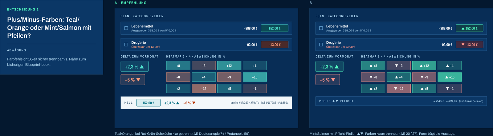
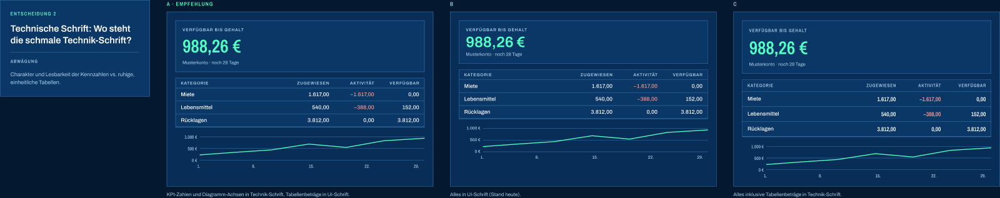
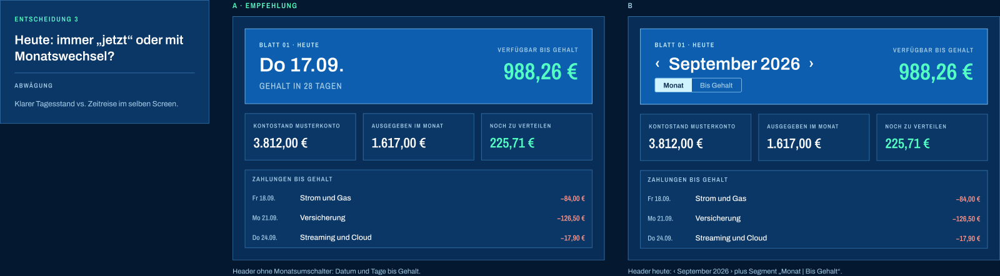
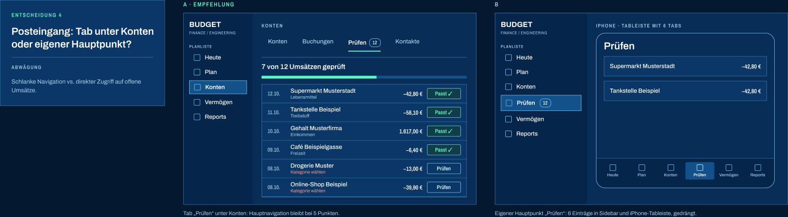
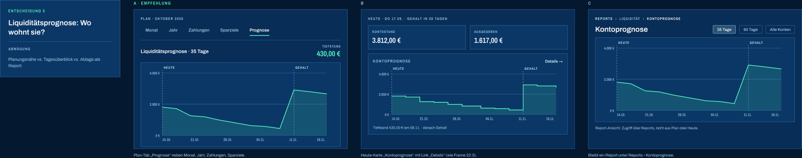
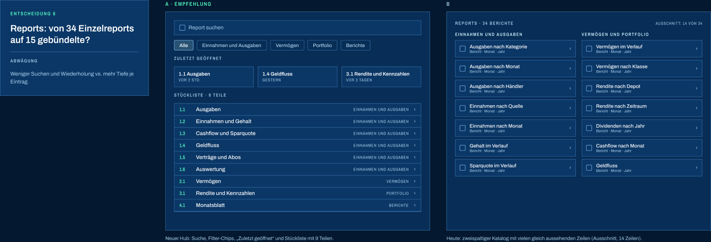
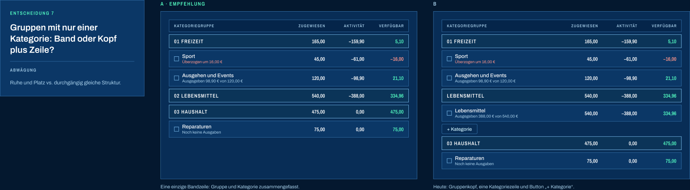
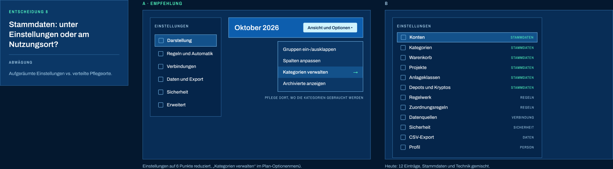
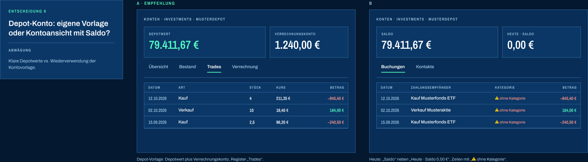

# UX-Audit 14.10.2026 (Web und iPhone)

Interdisziplinäres Audit der App (Stand main `3d164f93`) gegen den Figma-Entwurf **Blueprint Design V2** und die Owner-Richtung vom 14.10.2026: *Aufbau und Workflow wie Zerosum, Zeichnungssprache (Raster, Maßlinien, Stücklisten-Nummern) als Detailebene auf Übersichtsseiten.* Alle Bilder hier zeigen **synthetische Musterdaten**.

- Alle 149 Findings: [findings.md](findings.md)
- Figma-Entwurf (Soll-Inspiration): [Seite 00 · Alle Mockups](https://www.figma.com/design/Nv9oaV96Npql6onEofCFEi/?node-id=0-1) · Entscheidungsvarianten: [Seite 10 · Entscheidungen](https://www.figma.com/design/Nv9oaV96Npql6onEofCFEi/?node-id=58-2)
- Verwandte Vorgaben: `DESIGN.md`, `PRODUCT.md`, `SPEC.md`; Plan-Umbau Z1–Z4 (#448–#451)

## Ergebnis in Kürze
Starkes Fundament (Tokens als eine Quelle, Rückgängig überall, Rechnen im Feld, Maßketten), aber zu viel gleich laut übereinander. Heute, Plan und Posteingang beantworten ihre Leitfrage nicht in 5 Sekunden; der Buchungsdialog scheitert an Aufteilungen; die Zeichnungssprache liegt als Kostüm verstreut statt als System auf den Übersichten. „Dicke Linien“ kommen nicht von der Strichstärke (348 von 378 Rahmen sind 1 px), sondern von verschachtelten Boxen, 6–14-px-Balken, gesättigtem Rot für Vergangenes und Feldrahmen mit nur 1,73:1 Kontrast.

Severity: 4 Critical · 41 High · 76 Medium · 28 Low.

## Owner-Entscheidungen 14.10.2026
### 1 · Entscheidung 1A
Plus/Minus in **Teal/Orange** (dunkel `#4fe3d0`/`#ff9d7a`, hell `#0b7285`/`#b8380a`) plus Vorzeichen/▲▼.

Figma: [Zeile 1](https://www.figma.com/design/Nv9oaV96Npql6onEofCFEi/?node-id=58-8)

### 2 · Entscheidung 2B
Zahlen (Kennzahlen, Tabellen, Diagrammwerte) bleiben in **Archivo** (tabular). Barlow Semi Condensed nur für kleine Versal-Labels und Achsen.

Figma: [Zeile 2](https://www.figma.com/design/Nv9oaV96Npql6onEofCFEi/?node-id=58-23)

### 3 · Entscheidung 3B
Heute **behält** Monatsschalter und „Monat | Bis Gehalt“.

Figma: [Zeile 3](https://www.figma.com/design/Nv9oaV96Npql6onEofCFEi/?node-id=58-42)

### 4 · Entscheidung 4A
Posteingang wird Tab **„Prüfen“ unter Konten**, kein eigener Hauptpunkt.

Figma: [Zeile 4](https://www.figma.com/design/Nv9oaV96Npql6onEofCFEi/?node-id=58-57)

### 5 · Entscheidung 5B
Liquiditätsprognose wird **Heute-Karte „Kontoprognose“ + Detailseite**; im Graph muss der **Tiefststand** angezeigt werden.

Figma: [Zeile 5](https://www.figma.com/design/Nv9oaV96Npql6onEofCFEi/?node-id=58-72)

### 6 · Entscheidung 6A
Reports **34 → ~15** mit neuem Hub (Suche, Gruppen-Chips, Zuletzt geöffnet, Stückliste).

Figma: [Zeile 6](https://www.figma.com/design/Nv9oaV96Npql6onEofCFEi/?node-id=58-91)

### 7 · Entscheidung 7A
Gruppen mit genau einer Kategorie als **eine Zeile**.

Figma: [Zeile 7](https://www.figma.com/design/Nv9oaV96Npql6onEofCFEi/?node-id=58-106)

### 8 · Entscheidung 8A
**Stammdaten an den Nutzungsort**; Einstellungen nur Darstellung · Regeln und Automatik · Verbindungen · Daten und Export · Sicherheit · Erweitert.

Figma: [Zeile 8](https://www.figma.com/design/Nv9oaV96Npql6onEofCFEi/?node-id=58-121)

### 9 · Entscheidung 9A
**Eigene Depot-Vorlage**: Depotwert + Verrechnungskonto, Register „Trades“.

Figma: [Zeile 9](https://www.figma.com/design/Nv9oaV96Npql6onEofCFEi/?node-id=58-136)

## Pakete
Übersicht und Reihenfolge: #491.
Jedes Paket ist ein GitHub-Issue (Label `ux-audit`) mit den vollständigen Findings, Bildern, Umsetzungshinweisen und Akzeptanzkriterien. Reihenfolge: Quick Wins → Mittelfristig → Strategisch; Abhängigkeiten in der Spalte „Nach“.

| Paket | Phase | Titel | Findings | Aufwand | Nach | Issue |
|---|---|---|---|---|---|---|
| Q1 | Quick Win | Design-Tokens: Kontraste auf WCAG AA (Feldrahmen, Text 3, Dunkel-Grün) | D-08, D-20, A-24, D-35, B-34, C-33 | S | Kann sofort starten. Die volle Palette (Teal/Orange) folgt in DS-1. | #464 |
| Q2 | Quick Win | Rot nur für „jetzt handeln“: vergangene Verluste in Tusche, ein Alarmort | D-04, C-12 | S | Unabhängig. | #465 |
| Q3 | Quick Win | Heute: „Braucht Aufmerksamkeit“ verdichten, leere Blöcke ausblenden, Monatsschalter konsistent | A-04, A-05, A-22, A-35 | M | Vor H1 (Heute neu). | #466 |
| Q4 | Quick Win | Konten: Kontoseite und Übersicht klarer (Saldo, Prüfstatus, Kommend eingeklappt, Dichte) | C-03, C-04, C-05, C-10, C-11, C-17, C-32, C-34, C-35, A-08 | M | Unabhängig; vor K1. | #467 |
| Q5 | Quick Win | Navigation und iPhone-Rahmen: Register-Labels, Header, FAB, Fokusrahmen, ein Rückweg | B-12, C-26, B-23, C-16, A-21, B-37, A-15, A-17, B-32, A-25, C-31, B-38, A-09, A-20, C-29 | M | Unabhängig. Prognose-Tab entfällt mit H2. | #468 |
| Q6 | Quick Win | Sprache: Begriffe vereinheitlichen (Kategorie, Ausgabentempo, Sparziel/Monatsziel, Regel-Codes) | B-18, A-23, C-28, D-18, B-24, A-19, A-30 | S | Unabhängig; kleine Text-Konflikte mit Z2/Z3 möglich (dann rebasen). | #469 |
| Q7 | Quick Win | Tabellen und Diagramme: Abschneiden, iPhone-Überlauf, Achsen „Tsd. €“, Zahlenformat | D-07, D-06, D-12, C-25, C-22, D-19, D-30 | M | Unabhängig. | #470 |
| Q8 | Quick Win | Icons vereinheitlichen (Austauschliste, Größen, Strichstärke, keine Unicode-Glyphen) | D-24, D-39, B-36 | S | Unabhängig. | #471 |
| DS1 | Mittelfristig | Design-System v2 · Palette Teal/Orange und Farbrollen (Entscheidung 1A) | D-03, D-22, D-13, B-16 | M | Nach Q1. | #472 |
| DS2 | Mittelfristig | Design-System v2 · Typo-Skala verbindlich, Archivo für Zahlen (Entscheidung 2B) | D-11, D-23, B-33 | M | Nach DS1 oder parallel (andere Dateien). | #473 |
| DS3 | Mittelfristig | Design-System v2 · Linien, Balken, Radien, Schatten („dicke Linien“) | D-21, D-38, B-04, D-36 | M | Nach Z1 (#462) für die Plan-Balken. | #474 |
| H1 | Mittelfristig | Heute neu nach Figma: 3 Kennzahlen, Monatsverlauf, Vermögensverlauf, Zu tun, Fällig | A-01, A-02, A-03, A-07, A-36 | L | Nach Q3; H2 kann parallel (andere Karte). | #475 |
| H2 | Mittelfristig | Kontoprognose als Heute-Karte + Detailseite mit Tiefststand (Entscheidung 5B) | A-10, B-11, D-10, B-28 | L | Unabhängig von H1 (eigene Karte). | #476 |
| K1 | Mittelfristig | Konten › Prüfen: Umsätze mit Vorschlag, Fortschritt und Abgleich (Entscheidung 4A) | C-01, C-13, C-14, C-15 | L | Nach Q4. | #477 |
| K2 | Mittelfristig | Depot-Konto mit eigener Vorlage: Depotwert, Verrechnungskonto, Trades (Entscheidung 9A) | C-02 | M | Nach Q4. | #478 |
| K3 | Mittelfristig | Register und Buchungen: iPhone-Zeilen, Status-Legende, Flaggen, Filter, Kontakte | C-06, C-07, C-18, C-19, C-20, C-30 | M | Nach DS1 (Flaggenfarben) und #461. | #479 |
| V1 | Mittelfristig | Vermögen: Portfolio, Schulden, Freiheit, Sparplan, Handelsverlauf | C-08, C-09, C-21, C-23, C-24, C-27 | L | Unabhängig. | #480 |
| P1 | Mittelfristig | Plan: Einzelkategorie-Gruppen als eine Zeile (Entscheidung 7A) | B-15 | M | Nach Z1 #462 (gleiche Dateien), vor/zusammen mit Z2 #449. | #481 |
| P2 | Mittelfristig | Plan-Unterseiten: Einnahmen, Jahr, Zahlungen, Sparziel-Detail | B-13, B-25, B-26, B-27 | L | Nach Z3 #450 (Plan-Dateien). | #482 |
| M1 | Mittelfristig | Monatsabschluss: leere Schritte überspringen, Sammelbestätigung, Ergebnisseite | B-14, B-30, B-31 | M | Einstieg (sichtbarer Button) kommt mit Z2 #449. | #483 |
| S1 | Mittelfristig | Suche als Overlay-Palette (Strg K) mit Aktionen | A-16 | M | Unabhängig. | #484 |
| E1 | Strategisch | Stammdaten an den Nutzungsort: Kategorien in Plan, Anlageklassen in Portfolio (Entscheidung 8A) | A-06, A-28, A-29 | L | Nach Z2/Z3 (Plan-Optionen-Menü). | #485 |
| E2 | Strategisch | Einstellungen nach Aufgaben ordnen und Seiten aufräumen (Entscheidung 8A) | A-11, A-12, A-13, A-14, A-18, A-31, A-32, A-33 | M | Nach E1. | #486 |
| R1 | Strategisch | Reports-Hub: 34 → ~15 Auswertungen in 4 Gruppen (Entscheidung 6A) | D-01, D-02, D-09, D-15, D-34, D-40, D-27 | L | Nach H2 (Liquidität zieht um). | #487 |
| R2 | Strategisch | Report-Vorlage „Antwort zuerst“ für alle Reports | D-05, D-16, D-17, D-26, D-14, D-28, D-29, D-31, D-32, D-33 | L | Nach R1. | #488 |
| ZS1 | Strategisch | Zeichnungssprache als System auf Übersichtsseiten (Blatt/Rev, Raster, Positionsnummern) | D-25, D-37, A-34 | M | Nach DS1–DS3. | #489 |
| PUB1 | Strategisch · später | Später (Veröffentlichung): Login, Onboarding, Glossar | A-26, A-27 | L | Zuletzt. | #490 |

Bereits laufende Arbeit, die Findings mit abdeckt:

| Issue/PR | Thema | Findings |
|---|---|---|
| #449 | Z2 Plan-Kopf und Filterzeile | B-05, B-09, B-10, B-20, B-19 |
| #450 | Z3 Plan-Seitenliste | B-06, B-21, B-22 |
| #463 | Buchungsdialog Zeilenmodell | B-01, B-02, B-08, B-17, B-35 |
| #461 | Kontrollkästchen/Selects WebKit (PR) | B-29 |
| #462 | Z1 Plan-Raster (PR) | B-03, B-07 |

## Palette (Entscheidung 1A) {#palette}
Aus Figma Blueprint V2 gemessen; Kontraste nach WCAG 2.x gerechnet.

| Rolle | Dunkel | Kontrast (auf Karte) | Hell | Kontrast (auf Weiß) |
|---|---|---|---|---|
| Grund / Sidebar / Karte | `#082d56` / `#05254a` / `#0b3766` | – | `#eef3f9` / `#e3ebf5` / `#ffffff` | – |
| Karte 2 / aktiv | `#113b60` / `#175687` | – | `#f5f8fc` | – |
| Titelblock (eine Fläche je Seite) | `#0d5eae` | Text 6,14 | `#0d5eae` | Weiß 6,50 |
| Text / Text 2 / Text 3 | `#f4f9fe` / `#a6cee9` / `#8fb4d1` | 11,31 / 7,20 / 5,49 | `#0a2342` / `#36557a` / `#4d6a89` | 15,77 / 7,67 / 5,62 |
| Primary | `#d0f4ff` (Text `#082d56`) | 10,31 | `#0d5eae` (Text weiß) | 6,50 |
| Secondary | `#9ddafc` | 7,91 | `#0b3766` | 11,98 |
| Success (plus) | `#4fe3d0`, Soft `#0f4651` | 7,55 | `#0b7285`, Soft `#d8f1f3` | 5,59 |
| Warning | `#ffd37a`, Soft `#473d2b` | 8,47 | `#8a5300`, Soft `#fff3d6` | 6,33 |
| Error (minus, handeln) | `#ff9d7a`, Soft `#4a2c3c` | 5,91 | `#b8380a`, Soft `#fdeee6` | 5,82 |
| Info | `#9ddafc`, Soft `#12456f` | 7,91 | `#1d6fa5`, Soft `#e1effa` | 5,43 |
| Rahmen Feld / Linie | `#4987bc` / `#1f4d7c` | 3,12 / deko | `#6786ac` / `#d3deec` | 3,76 / deko |

Regeln: Success/Error immer mit Vorzeichen oder ▲▼; Heatmaps einfarbig (`secondary` 8–32 %) + Marker; Rot/Orange nie als Füllung für Vergangenes; Flaggen 4 Farben + Form; Lachs `#ff9d7a` nicht auf dem Titelblock (3,21:1), dort helles Lachs `#ffd0c4`.

## Typo-Skala (Entscheidung 2B) {#typo}
| Stufe | Einsatz | Font | Desktop px/LH | iPhone px/LH |
|---|---|---|---|---|
| T1 | Leitmaß | Archivo 640, tnum | 56/56 | 40/44 |
| T2 | Seitentitel | Archivo 650 | 28/32 | 24/28 |
| T3 | Abschnitt | Archivo 620 | 20/26 | 18/24 |
| T4 | Kartenkopf | Archivo 620 | 16/22 | 17/24 |
| T5 | Kennzahl in Karte | Archivo 640, tnum | 24/28 | 22/26 |
| T6 | Fließtext | Archivo 400 | 15/22 | 16/24 |
| T7 | Tabelle, Beträge | Archivo 400, tnum | 14/20 | 15/22 |
| T8 | Hinweis, Meta | Archivo 400, ink-3 | 13/18 | 13/18 |
| T9 | Tabellenkopf, Label (Versalien) | Barlow SC 500, +0,06 em | 12/16 | 12/16 |
| T10 | Achsen, Legende | Barlow SC 500, tnum | 12/16 | 12/16 |
| T11 | Maßtext, Positionsnummer | Barlow SC 600, tnum | 14/18 | 14/18 |
| T12 | Blatt/Rev-Zeile | Barlow SC 500, Versalien | 11/14 | 11/14 |

Mindestgröße 12 px (T12 nur auf dunkler Fläche ≥ 5,5:1); keine Literal-`font-size`.

## Linien, Radien, Flächen {#linien}
1 px Haarlinie für Struktur; 1 px Feldrahmen ≥ 3:1; 1,5 px nur Ist-Linien und Summen; Plan 1 px gestrichelt. Fortschrittsbalken 3–4 px, Stapelbalken ≤ 10 px mit 38–60 % Tönung. Keine Rahmen in Karten (Ghost-Buttons als Textbuttons). Radien 4 · 8 · 12 + Pille nur für Status. Karten-Schatten eine Lage.

## Icons {#icons}
| Alt | Neu |
|---|---|
| AlertTriangle / TriangleAlert / AlertCircle | TriangleAlert = Warnung, CircleAlert = Fehler, Info = Hinweis |
| CheckCircle2 / CircleCheck / CheckCheck | CircleCheck (Erfolg), Check (Liste) |
| Clock / Clock3 · ArrowRightLeft / ArrowLeftRight | Clock · ArrowLeftRight |
| Wallet (Plan) | Table2 oder LayoutGrid |
| BarChart3 / ChartNoAxesCombined (Reports) | ChartColumn |
| Glyphen „▾ › ✓ ⚠“, native details-Dreiecke | ChevronDown / ChevronRight / Check / TriangleAlert |
| Größen 9–26 px, Strich 0,5/1,75/2 | 16 · 20 · 24 px; Strich 1,75 (16) bzw. 1,5 (20/24) |

## Wireframes
Heute, Plan › Monat, Buchungsdialog (Desktop/iPhone), Konten › Prüfen und Report-Vorlage stehen als ASCII-Wireframes im Owner-Bericht; die wichtigsten sind in den Issues H1, H2, K1, R2 und #463 übernommen. Figma-Soll: [Heute](https://www.figma.com/design/Nv9oaV96Npql6onEofCFEi/?node-id=25-3), [Plan](https://www.figma.com/design/Nv9oaV96Npql6onEofCFEi/?node-id=12-2), [Konten](https://www.figma.com/design/Nv9oaV96Npql6onEofCFEi/?node-id=25-342), [Vermögen](https://www.figma.com/design/Nv9oaV96Npql6onEofCFEi/?node-id=25-685), [Kontoprognose](https://www.figma.com/design/Nv9oaV96Npql6onEofCFEi/?node-id=22-3).

## Content-Audit {#reports}
| Feature/Datenpunkt | Relevanz | Begründung | Platzierung | Veröff. |
|---|---|---|---|---|
| Verfügbar bis Gehalt (Leitzahl) | Must | Antwort auf „Kann ich ausgeben?“ | Heute, Kachel 1 | ja |
| Monatsergebnis (heute „Dieser Monat“) | Must | Spar-/Defizit-Info in einer Zahl | Heute, Kachel 2 | ja |
| Nettovermögen + 12-Monats-Verlauf | Must | Gesamtlage | Heute Kachel 3 + Graph; Detail in Vermögen | ja |
| Monatsverlauf Ausgaben mit Deckel | Must | Tempo im Monat | Heute, große Karte | ja |
| Braucht Aufmerksamkeit (verdichtet) | Must | Handlungsliste, eine Zeile je Quelle | Heute unter dem Hero | ja |
| Nächste Schritte | Remove | Doppelt zu Aufmerksamkeit | in „Zu tun“ | ja |
| Was steht an / Danach | Should | Fälligkeiten | Heute, eine 14-Tage-Liste | ja |
| Letzte Buchungen | Should | Kernaufgabe Kontrolle | Heute, iPhone direkt unter Hero | ja |
| Vermögensaufteilung auf Heute | Could | Doppelt zu Vermögen | Vermögen; Heute nur Mini-Balken | ja |
| Zu verteilen | Must | Auslöser Gehaltstag | Plan-Hero, rot unter 0 | ja |
| Zugewiesen / Aktivität / Verfügbar | Must | Kerntabelle | Plan-Raster | ja |
| Status-Satz + Ausgaben-Balken | Should | Ersetzt Klassenquadrate | Kategorie-Zeile (Z1) | ja |
| Klassenquadrat je Zeile | Remove | Für Verteilen irrelevant | Inspektor als Text | teilweise |
| Ansicht-Select (5 Views) | Could | Dubletten zu Filtern | Optionen-Menü | teilweise |
| Wasserfall-Stufen | Should | Eigenes Modell | Verteilen-Assistent | ja |
| 50/30/20 im Plan | Could | Regelwerk, nicht Planen | Reports | teilweise |
| Monatsabschluss-Einstieg | Must | Monatsroutine | Sichtbarer Button im Plan-Kopf | ja |
| Liquiditätsprognose | Must | „Geht sich das aus?“ | Plan › Prognose (oder Heute) | ja |
| Chips Heute/Gestern im Dialog | Remove | Doppelt zur Datumseingabe | – | ja |
| „Auslage für Kontakt“ + „Split“ | Remove | Ersetzt durch „Teilen“ | In der Zeile | ja |
| Saldo + Prüfstatus je Konto | Must | „Stimmt das Konto?“ | Kontenliste, Kontokopf | ja |
| „davon vorgemerkt“ | Should | Erklärt Differenz zur Bank | Zweitzeile klein | ja |
| Kommend im Register | Should | Liquiditätsblick | Eingeklappt mit Einzeiler | ja |
| Mini-Sparklines je Kontokarte | Could | Delta unklar | Entfernen | teilweise |
| Flaggen (6 Farben) | Could | Selten genutzt, Farbhürde | 4 Markierungen mit Form | ja |
| Posteingang: Umsatz-Vorschläge | Must | Kern der Eingangskontrolle | „Prüfen“ oben | ja |
| Posteingang: überzogene Kategorien | Should | Plan-Thema | Plan-Kopf | ja |
| Nettovermögen-Hero auf Konten | Remove | Doppelt zu Vermögen | Link auf Vermögen | ja |
| Portfolio-Wert + Gewinn € und % | Must | Kern Portfolio | Portfolio-Hero | ja |
| TWR/IRR | Should | Eine Renditezahl reicht | Zeile mit ⓘ | ja |
| Klumpenrisiko, Brutto-Exposition, R-Codes | Could | Nur bei Verletzung relevant | Hinweis bei Verletzung | teilweise |
| Stückzahlen mit 8–9 Dezimalen | Remove | Rauschen | 4 Stellen, Tooltip | ja |
| Schulden: Restschuld, Rate, Zins | Must | Kern Schulden | Hero + Tabelle | ja |
| „unbekannt“-Felder ×8 | Remove | Fehlerwand | Aktion „Konditionen ergänzen“ | ja |
| Reports 1.3 Einnahmen · 1.7 Sparquote · 2.1 Ausgaben · 4.4 Rendite | Must | Kontrolle und PP-Ersatz | Reports, Hauptauswertungen | ja |
| Reports 1.1 One-Pager · 1.4 Geldfluss · 2.3 Verträge · 3.2 Cashflow · 3.6 Vermögen · 4.1 Depots · 4.5 Kosten · 5.1 Jahresreport · 5.5 Vergleich | Should | Gezielte Auswertungen | Reports (teils als Tabs zusammengelegt) | ja |
| Reports 1.5 Jahresansicht · 5.3 Explorer | Should | Tabellen-Werkzeug | „Auswertung“ mit Presets | ja |
| Reports 1.8 Gesamttabelle · 1.10 Ein- und Ausgaben | Remove | Doppelt | in Auswertung / Cashflow | – |
| Reports 1.11 Prognosegenauigkeit · 3.3 Vermögensverläufe · 3.4 Jahresvorschau · 3.5 Sparziele · 5.4 Kontakte | Remove | Leer oder Spiegel eines Bereichs | im jeweiligen Bereich | – |
| Reports 1.9 Projekte · 2.4 Inflation · 2.6 Bank-/Zinskosten · 5.2 Finanz-Check · 5.6 Gesamtübersicht · 4.3 Einzahlungen | Could | Spezialthemen | als Tab/Abschnitt eines Hauptreports | teilweise |
| Methodentexte in Reports | Should | Vertrauen, aber zu viel Platz | Einklappbar am Seitenende | ja |
| Regel-IDs R01–R22 im Text | Remove | Entwicklungsjargon | Tooltip | – |
| Warenkorb-Einstellungen | Could | Expertenfunktion | am Inflations-Report | teilweise |
| CSV-/ZIP-Export mit Backup-Status | Should | Datenhoheit | Einstellungen › Daten und Export | ja |
| Globale Suche | Must | Findability bei vielen Seiten | Overlay-Palette | ja |

## Testplan
Selbsttest mit Stoppuhr vor/nach jedem Paket (iPhone und Desktop): Barzahlung erfassen ≤ 10 s · Restaurant 120 €, Hälfte Kontakt ≤ 20 s · „Hält der Monat?“ auf Heute ≤ 5 s · Wochenumsätze prüfen bis „Konto stimmt“ ≤ 10 min · überzogene Kategorie decken mit 1 Klick · Gehalt verteilen in 2 Schritten · „Lebensmittel im August?“ finden. 5-Sekunden-Test Heute/Plan alt vs. neu mit 5 Personen (Ziel ≥ 4/5).
